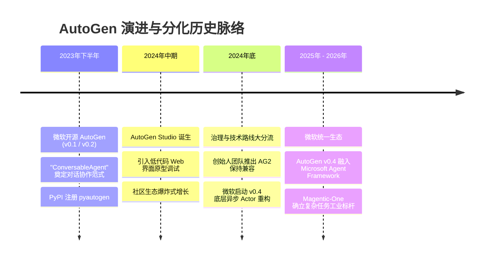
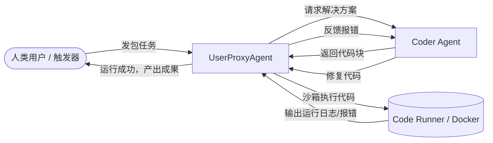
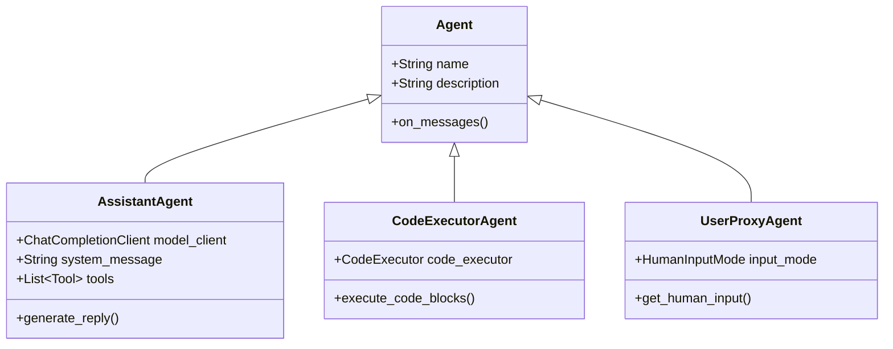
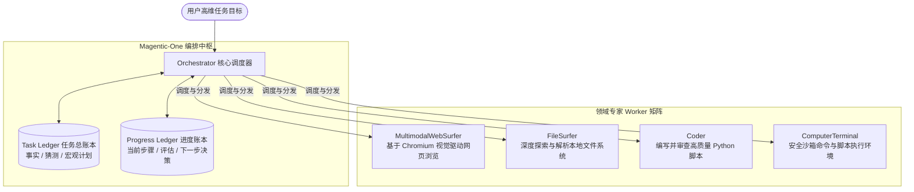
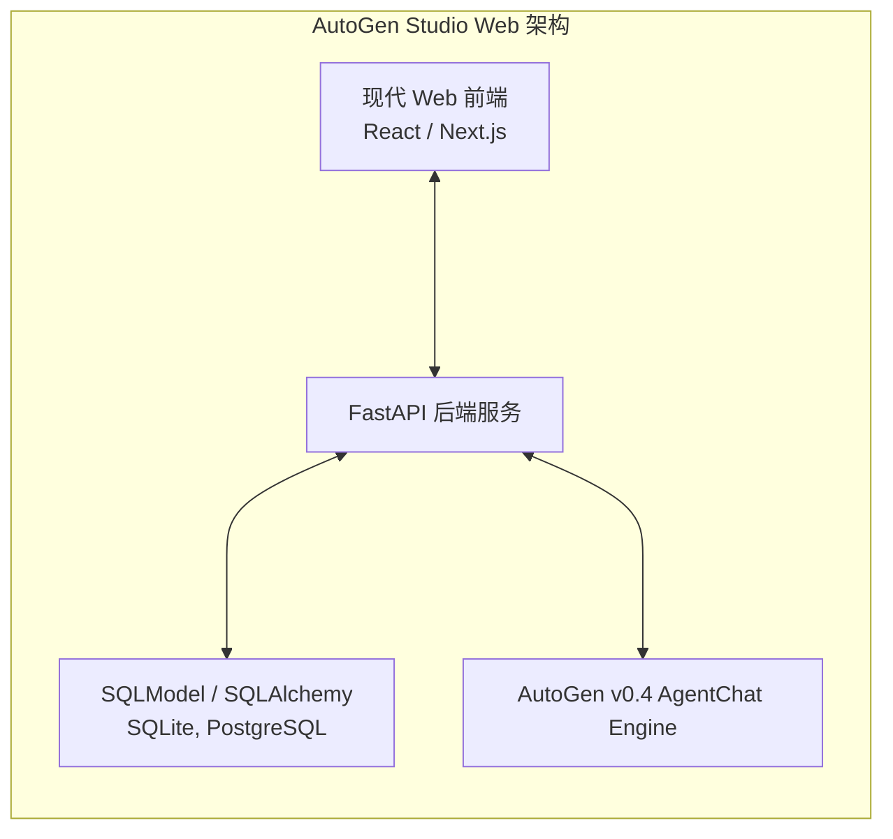

+++
title = "AutoGen学习文档"
slug = "autogen-learning-notes"
weight = 11
categories = ["Frameworks", "AutoGen"]
tags = ["AutoGen", "Agent"]
description = "AutoGen学习文档相关学习笔记与实践要点。"
+++
# AutoGen 框架深度解析与全景知识总结报告

> **编制日期**：2026年11月  
> **报告归档目录**：`D:\那就，战个未来吧\content\Frameworks\AutoGen`  
> **适用版本**：Microsoft AutoGen v0.4+（现代 Actor 架构）、AG2 / pyautogen（经典兼顾版）及 AutoGen Studio

---

## 目录
1. [框架背景与发展演变：起源、分歧与现状](#1-框架背景与发展演变起源分歧与现状)
2. [核心设计范式：对话即计算 vs Actor 模型](#2-核心设计范式对话即计算-vs-actor-模型)
3. [AutoGen v0.4 现代化架构分层剖析](#3-autogen-v04-现代化架构分层剖析)
4. [核心构件与关键抽象](#4-核心构件与关键抽象)
5. [多智能体编排与协作拓扑模式](#5-多智能体编排与协作拓扑模式)
6. [旗舰级通用多智能体系统：Magentic-One 架构](#6-旗舰级通用多智能体系统magnetic-one-架构)
7. [关键机制详解：代码沙箱执行、终止条件与人机协同](#7-关键机制详解代码沙箱执行终止条件与人机协同)
8. [可视化与低代码中枢：AutoGen Studio](#8-可视化与低代码中枢autogen-studio)
9. [主流多智能体框架横向对比：AutoGen vs LangGraph vs CrewAI](#9-主流多智能体框架横向对比autogen-vs-langgraph-vs-crewai)
10. [工业级实战代码样例大全](#10-工业级实战代码样例大全)
11. [生产落地挑战、防坑指南与最佳实践](#11-生产落地挑战防坑指南与最佳实践)

---

## 1. 框架背景与发展演变：起源、分歧与现状

### 1.1 起源与核心愿景
AutoGen 最早由 **微软研究院（Microsoft Research）** 联合宾夕法尼亚州立大学与华盛顿大学团队于 2023 年秋季开源推出（主创团队包括 Chi Wang、Qingyun Wu 等人）。其诞生的初衷是为了打破单一 LLM 提示工程（Prompt Engineering）的能力瓶颈，通过模拟人类团队在面对复杂多步骤问题时的**多角色分工协作、批判审查、动态反馈与工具调用**，来完成复杂的自动化软件工程、数据科学研究及多步骤推理任务。

AutoGen 首创了以**“对话（Conversation）”作为多智能体交互的统一通信范式**，让 Agent 之间的协作就像工程师团队在 Slack / 钉钉群聊中交流一样自然，迅速成为开源界最受欢迎的多智能体框架之一。



---

### 1.2 历史分歧：AG2 与 Microsoft AutoGen (v0.4+) 的双轨现状

在 2024 年末，AutoGen 社区经历了一次重大的技术与治理分水岭，了解这一分歧对于当下开发者选型至关重要：

| 维度 | AG2 (原团队 / 社区分支) | Microsoft AutoGen (微软官方分支 v0.4+) |
| :--- | :--- | :--- |
| **所属组织 / 仓库** | `ag2ai/ag2`（独立社区基金会） | `microsoft/autogen`（微软企业级主导） |
| **PyPI 包名** | `autogen`, `pyautogen`, `ag2` | `autogen-agentchat`, `autogen-core`, `autogen-ext` |
| **设计哲学** | **向后兼容优先**，延续经典对话 API，演进为全功能 AgentOS | **彻底重写重构**，引入底层 Actor 模型与异步事件总线，面向高并发与分布式 |
| **核心 API 风格** | `ConversableAgent`, `GroupChat`, `GroupChatManager`（同步阻塞或原生循环） | 异步/事件驱动（`asyncio`）、`AssistantAgent`、`RoundRobinGroupChat`、`SelectorGroupChat` |
| **典型生态配合** | 适合习惯 v0.2/v0.3 教程、快速脚本、丰富社区插件的开发者 | 适合需要企业级分布式部署、高可观测性、对接微软 Agent Framework / Semantic Kernel 的团队 |

> [!IMPORTANT]
> **安装与导入防坑提示**：
> - 如果执行 `pip install autogen` 或 `pip install pyautogen`，安装的是 **AG2（经典兼容分支）**。
> - 如果要使用微软最新的现代化架构，应安装：`pip install -U autogen-agentchat autogen-ext[openai]`。
> - 本报告将重点以**现代 v0.4+ 架构**为主轴进行深度解构，同时兼顾经典的 v0.2 / AG2 核心理念，提供全景认知。

---

## 2. 核心设计范式：对话即计算 vs Actor 模型

### 2.1 传统理念：“对话即计算”（Conversation as Computation）
在经典的 AutoGen 设计中，核心哲学是：
1. **统一接口**：任何能够发送和接收消息的实体都可以抽象为一个 Agent（无论是大模型、Python 代码执行器、数据库代理、还是坐在电脑前的人类）。
2. **状态共享与推进**：计算过程不是由硬编码的控制流（如 if-else）决定的，而是由 Agent 发送的消息流驱动。一条消息既是**交流媒介**，也是**计算输入**。



这种机制极大降低了构建多角色协同的门槛，但也暴露出了局限：高度依赖 Chat Loop 循环，长流程下容易死循环、缺乏强类型事件约束、分布式横向扩展困难。

### 2.2 现代演进：基于 Actor 模型的事件驱动架构
在 AutoGen v0.4+ 中，系统引入了计算机科学经典的 **Actor 模型（Actor Model）**：
- **完全解耦与隔离**：每一个 Agent 都是一个完全独立的 Actor，拥有自己私有的内部状态，彼此之间绝不共享内存或直接调用对方的内部方法。
- **消息总线传递（Message Passing）**：Agent 之间唯一的交互方式是向**代理运行时（Agent Runtime）**的消息总线投递强类型消息包。
- **异步响应驱动**：Agent 监听特定类型的事件/消息，非阻塞地进行推理、工具调用或状态变更，随后向外广播事件或定向回复。

这一转变使 AutoGen 从“实验性脚本库”蜕变为具备**高并发处理能力、分布式跨机通信潜力与工业级 OpenTelemetry 追踪能力**的企业级基础平台。

---

## 3. AutoGen v0.4 现代化架构分层剖析

现代 AutoGen 采用了优雅的三层分层架构，从底层运行时到顶层高阶协作进行彻底解耦：

```text
+---------------------------------------------------------------------------------+
|                                 Extensions Layer                                |
|                                  (autogen-ext)                                  |
|   - 模型客户端: OpenAI, Azure OpenAI, Anthropic, Gemini, Ollama, LiteLLM        |
|   - 代码沙箱: DockerCommandLineCodeExecutor, LocalCommandLineCodeExecutor        |
|   - 向量检索与缓存: Qdrant, Chroma, Redis                                        |
+---------------------------------------------------------------------------------+
                                         ▲
                                         │  集成插件与服务
+---------------------------------------------------------------------------------+
|                                 AgentChat Layer                                 |
|                               (autogen-agentchat)                               |
|   - 智能体定义: AssistantAgent, CodeExecutorAgent, UserProxyAgent               |
|   - 协作拓扑: RoundRobinGroupChat, SelectorGroupChat, Swarm                     |
|   - 控制原语: TerminationConditions (AND / OR / Regex), Console UI 实时流        |
+---------------------------------------------------------------------------------+
                                         ▲
                                         │  构建于运行时之上
+---------------------------------------------------------------------------------+
|                                   Core Layer                                    |
|                                 (autogen-core)                                  |
|   - Actor Runtime: AgentId, SingleThreadedAgentRuntime, 消息总线路由           |
|   - 事件驱动基石: 强类型消息（Typed Message Handler）、订阅与广播机制            |
|   - 状态追踪与可观测性: OpenTelemetry 分布式跟踪, 上下文生命周期管理                |
+---------------------------------------------------------------------------------+
```

### 3.1 `autogen-core`：底层基础设施与 Actor 运行时
- **`AgentRuntime`**：Actor 的托管容器与路由中心，负责管理 Agent 实例的注册、生命周期、跨 Actor 投递消息。
- **`AgentId`**：全局唯一的身份标识（由 `type` 和 `key` 组成），支持多租户和多会话隔离。
- **消息协议与类型派发**：通过 Python 的类型注解和处理装饰器（如 `@message_handler`），让 Agent 只响应其关心的事件消息，极大增强了鲁棒性。

### 3.2 `autogen-agentchat`：高阶协作抽象层
大部分应用开发者直接接触该层：
- 提供面向自然语言对话的标准 Agent 封装。
- 提供了高度成熟的多智能体团队（Teams）模式，无需开发者从底层编写消息广播逻辑。
- 统一的异步流式接口（`run()` 与 `run_stream()`），无缝支撑 Web 前端实时打字机效果。

### 3.3 `autogen-ext`：连接外部生态的扩展桥梁
保持核心最小化的关键。无论是不同的模型厂商驱动、代码安全沙箱、还是各种内存与向量数据库，均作为可选插件在此模块发布，避免依赖膨胀。

---

## 4. 核心构件与关键抽象

### 4.1 智能体角色（Agents）



1. **`AssistantAgent`（LLM 助理）**：
   - 依赖底层的 `ChatCompletionClient` 调用模型。
   - 具备系统提示词（`system_message`）与工具（`tools`）注册能力。
   - 必须配置清晰的 `description`。在多智能体动态路由中，路由选择器根据 `description` 来评估由谁接管任务。
2. **`CodeExecutorAgent`（代码执行专员）**：
   - 不依赖大语言模型进行文本生成，其职责是专门扫描上一轮对话中的 Markdown 代码块（如 ` ```python ... ``` `），将其送入沙箱环境运行，并将执行输出（STDOUT / STDERR）作为新消息返回。
3. **`UserProxyAgent`（人类代理）**：
   - 作为现实世界用户与数字智能体群之间的桥梁，支持配置人工介入模式（如每轮必确认、仅在报错时确认、完全自动）。

---

### 4.2 团队与编排容器（Teams）
在 v0.4 中，多个 Agent 协同的容器统称为 **Team**。Team 统一实现了任务派发、对话历史维持、流式状态广播以及终止条件裁决。
- `team.run(task="...")`：返回最终的执行汇总（TaskResult）。
- `team.run_stream(task="...")`：返回异步生成器，实时捕获每一个内部事件（发言、思考、工具调用、工具返回）。

---

### 4.3 强类型终止条件（Termination Conditions）
避免无限递归或无休止的“客套对话”（如 A说“谢谢”，B说“不客气”，A又说“应该的”）是多智能体系统的核心难题。现代 AutoGen 提供了强大的组合式终止条件系统：
- **`TextMentionTermination(text="TERMINATE")`**：当任意消息中出现指定终止关键词时触发。
- **`MaxMessageTermination(max_messages=10)`**：对话总消息数达到上限时强制刹车，作为防止 Token 爆炸的安全底线。
- **`StopMessageTermination()`**：当智能体发出特定的显式 Stop 信号时触发。
- **逻辑运算符重载**：
  - `condition_a | condition_b`：**或（OR）逻辑**，只要满足其一即终止。
  - `condition_a & condition_b`：**与（AND）逻辑**，必须全部满足才终止。

---

## 5. 多智能体编排与协作拓扑模式

AutoGen 提供了从简单到高度复杂的全谱系协作拓扑结构：

```mermaid
flowchart TD
    subgraph 模式A: 轮询协作 (RoundRobin)
        A1[Agent 1] --> A2[Agent 2] --> A3[Agent 3] --> A1
    end

    subgraph 模式B: 动态选择器 (SelectorGroupChat)
        M[Selector / Router]
        M -->|1. 分析上下文| B1[Planner]
        M -->|2. 调度执行| B2[Coder]
        M -->|3. 调度校验| B3[Reviewer]
        B1 -.->|返回结果| M
        B2 -.->|返回结果| M
        B3 -.->|返回结果| M
    end

    subgraph 模式C: 蜂群交接 (Swarm / Handoffs)
        S1[FrontDesk] -->|Handoff: 账务问题| S2[BillingAgent]
        S1 -->|Handoff: 技术故障| S3[TechSupport]
        S3 -->|Handoff: 需要退款| S2
    end
```

### 5.1 轮询协作（RoundRobinGroupChat）
- **机制**：智能体按照预先定义的数组顺序依次轮流发言。
- **适用场景**：线性工作流，如【需求分析师 $\rightarrow$ 架构设计师 $\rightarrow$ 编码工程师 $\rightarrow$ 测试人员】。
- **优缺点**：逻辑清晰、执行顺序 100% 确定；但缺乏根据运行时突发情况动态调整人员的能力。

### 5.2 动态选择器群聊（SelectorGroupChat）
- **机制**：内部配备一个独立的“路由大模型”，在每一轮对话结束时，该模型阅读当前全量对话记录以及每个 Agent 的 `description`，动态判断下一轮最适合发言的成员。
- **关键参数**：
  - `allow_repeated_speaker=False`：防止同一个 Agent 连续自我对话陷入死循环。
  - `selector_prompt`：可定制选择器的决策依据和规则。
- **适用场景**：开放式探索、故障排查、复杂调试闭环（例如：Coder 编写 $\rightarrow$ Executor 运行 $\rightarrow$ 报错 $\rightarrow$ Coder 修复；Reviewer 只有在运行成功后才切入验证）。

### 5.3 蜂群交接模式（Swarm & Handoffs）
- **机制**：受到 OpenAI Swarm 的启发，由当前的执行 Agent 自主决定何时何地将当前对话上下文与控制权“交接（Handoff）”给指定名字的目标 Agent。
- **适用场景**：多分支客服系统、分诊引导、多级审批系统。

### 5.4 层次化与社会心智模式（Society of Mind / Hierarchical）
- **机制**：将一个内部由多个 Agent 组成的复杂 Team 封装为一个对外的单一“虚拟 Agent”。对于外部观察者而言，它表现为一个输入输出接口；在内部，它启动子会话完成深度分工。
- **适用场景**：超大规模项目管理、跨领域知识集成、隔离子任务上下文（防止子任务的繁琐交互污染主上下文）。

---

## 6. 旗舰级通用多智能体系统：Magentic-One 架构

在 AutoGen v0.4 中，微软推出了其集大成的通用多智能体参考架构 —— **Magentic-One**（发表于顶级学术评测，专为解决跨 Web 与复杂本地文件系统的长时间开放性任务设计）。



### 6.1 双层推理循环（Dual-Loop Mechanism）
Magentic-One 克服复杂长程任务失控的关键，在于其著名的“双账本双循环”设计：
1. **外层循环（Task Ledger & 宏观规划）**：
   - 维护结构化的**任务总账本**（Task Ledger），详细记录当前已确认的客观事实（Facts）、尚待求证的推论（Educated Guesses）以及分步实施计划。
   - 当任务遭遇重大挫折、路线走不通或内层循环多次重试失败时，触发外层规划重置（Replanning），推翻旧计划并重构路线。
2. **内层循环（Progress Ledger & 微观执行）**：
   - 维护**执行进度账本**（Progress Ledger），跟踪当前这一微观步骤是否完成、下一步应当委派哪个专属 Agent 进行操作。

### 6.2 专属专家矩阵
- **MultimodalWebSurfer**：结合视觉与 DOM 树的网页冲浪专员，能自主点击、滚动、填写表单、阅读验证码与抓取图文信息。
- **FileSurfer**：擅长在复杂的本地文件目录中检索、分析结构化与非结构化文件（PDF、Excel、CSV 等）。
- **Coder & ComputerTerminal**：代码构思与命令行执行的黄金搭档，负责数值计算、数据整理与环境交互。

---

## 7. 关键机制详解：代码沙箱执行、终止条件与人机协同

### 7.1 安全隔离的代码执行机制
AutoGen 与其他框架最显著的区别之一，是其自诞生起就将“代码生成与就地运行反馈”作为一等公民（First-class Citizen）。

```text
[智能体产出 Markdown 文本]
           │
           ▼
[代码提取器识别 ```python ... ``` 块]
           │
           ▼
┌─────────────────────────────────────────────────────────────┐
│                    执行器选择 (Code Executor)                │
├──────────────────────────────┬──────────────────────────────┤
│  LocalCommandLineCodeExecutor│ DockerCommandLineCodeExecutor│
│  - 本地宿主机进程环境运行    │ - 容器安全隔离               │
│  - 响应速度快，开箱即用      │ - 避免删库/注入攻击风险      │
│  - 仅推荐本地测试调试        │ - 企业级生产环境强制规范     │
└──────────────────────────────┴──────────────────────────────┘
           │
           ▼
[捕获返回 Exit Code, STDOUT, STDERR]
           │
           ▼
[作为消息重注入会话，由 Agent 评估或自我修复]
```

> [!CAUTION]
> **生产安全警示**：永远不要在没有隔离措施的生产服务器上，使用 `LocalCommandLineCodeExecutor` 运行未经审核的 Agent 生成代码！必须使用 Docker 沙箱或云端隔离容器（如 Azure Container Apps, E2B 沙箱）。

---

### 7.2 动态人机协同（Human-in-the-Loop, HITL）
AutoGen 允许人类随时作为最高裁决者介入流程。在 v0.4 中，主要通过以下方式实现：
1. **拦截批准机制（Approval Handlers）**：在工具调用或代码执行前，挂载审批钩子函数。如果操作涉及危险命令（如删除数据库、发送外部邮件），挂起等待用户终端或 Web 端确认。
2. **`UserProxyAgent` 交互注入**：配置输入模式：
   - `ALWAYS`：每一步执行完毕均暂停并要求人类输入下一步指令或评价。
   - `NEVER`：完全自动化运行，直至触发终止条件。
   - `TERMINATE`：仅在 Agent 准备结束会话时，询问人类是否认可结果；若不认可，可输入反馈让 Agent 继续修改。

---

## 8. 可视化与低代码中枢：AutoGen Studio

为了降低多智能体系统的配置门槛，微软推出了配套的可视化工作台 —— **AutoGen Studio**（在 v0.4 伴随底层进行了全面重构）。



### 8.1 核心功能板块
1. **Team Builder（团队构建画布）**：
   - 可视化配置 Agent 的 System Message、模型参数（Temperature、Top_p）、绑定工具（Skills）与终止规则。
   - 以声明式 JSON / YAML Schema 导出配置，方便 Git 版本控制与 CI/CD 交付。
2. **Playground（交互式试验场）**：
   - 提供类似聊天界面的对话控制台，支持**实时打字机流式展示**思考轨迹（Thoughts）与工具输出。
   - **交互拓扑图（Transition Graph）**：可视化显示当前轮次信息在哪个 Agent 之间流转。
   - **中途打断与状态回滚（Mid-Execution Control）**：可在 Agent 偏离预期时暂停任务，修正上下文后继续。
3. **Gallery（模板画廊）**：
   - 沉淀官方与社区的最佳实践模板（如数据分析套件、学术论文精读团队、代码审查流水线），一键拉起复用。

### 8.2 快速启动指南
```bash
# 1. 安装 AutoGen Studio
pip install autogenstudio

# 2. 设置大模型 API 密钥 (Windows PowerShell)
$env:OPENAI_API_KEY="sk-..."

# 3. 启动本地 Web 服务
autogenstudio ui --port 8081
```
*浏览器访问 `http://localhost:8081` 即可进入可视化操作界面。*

---

## 9. 主流多智能体框架横向对比：AutoGen vs LangGraph vs CrewAI

在当前的技术生态中，**AutoGen**、**LangGraph** 与 **CrewAI** 形成了三足鼎立的局面。下表从底层原理到适用场景进行了全维度剖析：

| 评估维度 | AutoGen (v0.4+ / AG2) | LangGraph | CrewAI |
| :--- | :--- | :--- | :--- |
| **底层核心范式** | **对话协商与 Actor 消息传递**<br>（Conversational / Actor-based） | **状态图与有限状态机**<br>（StateGraph / Pregel DAGs） | **拟人化角色与任务链**<br>（Role-Playing Task Teams） |
| **控制流确定性** | **中 $\rightarrow$ 高**<br>通过 Team 类型与终止条件约束，自组织性强 | **极高**<br>通过显式边（Edges）和条件分支精确编码 | **中等**<br>通过 Crew 序列或层级委派执行，强调角色扮演 |
| **状态持久化与回滚** | **成熟中**<br>v0.4 依靠 Actor 状态与 Studio 数据库存储 | **原生顶级**<br>内置 Checkpointer，完美支持 Time-Travel 回滚与分支 | **良好**<br>提供短期、长期与实体记忆库，易于开箱即用 |
| **代码执行与纠错能力** | **天花板级别**<br>原生将代码沙箱与自我调试作为核心交互机制 | **需自行组装**<br>需编写对应节点并挂载沙箱工具 | **良好**<br>内置基础代码执行工具，但交互循环略重 |
| **上手门槛与研发周期** | **快（2~6小时）**<br>AgentChat 高层封装优雅，开箱即用 | **陡峭（2~5天）**<br>需要深入理解图论、Reducer 及状态模式 | **极快（1~3小时）**<br>直观的“角色、目标、背景故事、任务”抽象 |
| **企业生产就绪度** | **高**<br>微软背书，集成分布式运行时与 OTEL 遥测 | **极高**<br>LangSmith 生态协同，强合规金融/法律场景首选 | **高**<br>CrewAI Enterprise 企业平台支持 |
| **最佳匹配业务场景** | **研发协同、代码调试、复杂探索性分析、Magentic 级多工具联动作业** | **确定性极强的工作流、高合规审批流、强依赖分支回溯的业务** | **内容生产矩阵、营销策划、固定流程的信息收集与汇总** |

---

## 10. 工业级实战代码样例大全

以下代码均基于现代 **AutoGen v0.4+ (`autogen-agentchat`, `autogen-ext`)** 规范编写，采用原生 `asyncio` 与强类型架构。

### 10.1 场景一：双智能体协同思考与流式输出（规划者 + 创作者）

```python
import asyncio
from autogen_agentchat.agents import AssistantAgent
from autogen_agentchat.conditions import MaxMessageTermination, TextMentionTermination
from autogen_agentchat.teams import RoundRobinGroupChat
from autogen_agentchat.ui import Console
from autogen_ext.models.openai import OpenAIChatCompletionClient


async def run_round_robin_demo():
  # 1. 实例化底层大模型客户端
  model_client = OpenAIChatCompletionClient(
      model="gpt-4o",
      # api_key="sk-..." 可从环境变量 OPENAI_API_KEY 自动读取
  )

  # 2. 定义角色清晰的专家 Agent
  planner = AssistantAgent(
      name="Architect",
      model_client=model_client,
      system_message=(
          "你是一位资深系统架构师。面对用户的需求，请给出精炼的 3 步高可用设计框架。"
          "不要长篇大论，突出技术选型与关键考量。"
      ),
  )

  engineer = AssistantAgent(
      name="Engineer",
      model_client=model_client,
      system_message=(
          "你是一位资深全栈研发工程师。根据架构师给出的方案，给出具体的实现要点或伪代码。"
          "当确认设计与实现完整闭环后，请在回复末尾附带严格的单词：TERMINATE。"
      ),
  )

  # 3. 设置鲁棒的组合终止条件（满足其一即停）
  # - 文本中包含 TERMINATE
  # - 或对话达到 6 轮防死锁上限
  termination = TextMentionTermination("TERMINATE") | MaxMessageTermination(
      max_messages=6
  )

  # 4. 构建轮询编排团队
  team = RoundRobinGroupChat(
      participants=[planner, engineer], termination_condition=termination
  )

  # 5. 启动任务并以控制台流式渲染
  task_prompt = "请为日均千万级请求的短链接系统设计一套后端架构。"
  print(f"=== 开始执行任务: {task_prompt} ===\n")

  # Console 自动流式打印每个 Agent 的回复与状态
  await Console(team.run_stream(task=task_prompt))
  print("\n=== 任务执行结束 ===")


if __name__ == "__main__":
  asyncio.run(run_round_robin_demo())
```

---

### 10.2 场景二：动态路由（Selector）+ 本地安全代码执行闭环

此场景展示动态自主调度：大模型根据当前进度自动选择是该“编码”、“运行代码”还是“验收确认”。

```python
import asyncio
from autogen_agentchat.agents import AssistantAgent, CodeExecutorAgent
from autogen_agentchat.conditions import TextMentionTermination
from autogen_agentchat.teams import SelectorGroupChat
from autogen_agentchat.ui import Console
from autogen_ext.code_executors.local import LocalCommandLineCodeExecutor
from autogen_ext.models.openai import OpenAIChatCompletionClient


async def run_code_execution_selector_demo():
  model_client = OpenAIChatCompletionClient(model="gpt-4o")

  # 1. 编程专家：输出规范的 markdown 代码块
  coder = AssistantAgent(
      name="PythonCoder",
      model_client=model_client,
      description="精通 Python 的算法工程师。负责编写完整的、可直接运行的代码块来解决问题。",
      system_message=(
          "你是一名资深 Python 开发者。请针对任务编写无外部危险依赖的高效代码。"
          "务必将代码包裹在 ```python ... ``` 格式的 markdown 代码块中。"
      ),
  )

  # 2. 代码执行专员：只负责运行代码并捕获控制台输出
  workspace_dir = "./coding_workspace"
  local_executor = LocalCommandLineCodeExecutor(work_dir=workspace_dir)
  executor = CodeExecutorAgent(
      name="CodeRunner",
      code_executor=local_executor,
      description="代码执行专员。负责运行上文对话中的 Python 代码，并反馈控制台标准输出和错误。",
  )

  # 3. 质量审查与验收员
  reviewer = AssistantAgent(
      name="QualityReviewer",
      model_client=model_client,
      description="质量评估专家。审查运行结果是否正确，决定是否验收通过。",
      system_message=(
          "你负责审查代码执行返回的结果是否完全符合用户需求。"
          "如果运行报错，请指出问题并要求 PythonCoder 修复；"
          "如果计算结果准确无误，请在发言末尾输出 TERMINATE。"
      ),
  )

  # 4. 终止条件
  termination = TextMentionTermination("TERMINATE")

  # 5. 构建动态选择器团队（SelectorGroupChat）
  # Selector 会利用 model_client 来分析各 Agent 的 description 并决定下一位发言人
  team = SelectorGroupChat(
      participants=[coder, executor, reviewer],
      model_client=model_client,
      termination_condition=termination,
      allow_repeated_speaker=False,  # 强制禁止同一个智能体连续发言两次
  )

  task = "请计算第 30 个斐波那契数列的值，并计算前 30 个数的总和，打印输出结果。"
  print(f"=== 动态协同执行任务: {task} ===\n")
  await Console(team.run_stream(task=task))


if __name__ == "__main__":
  asyncio.run(run_code_execution_selector_demo())
```

---

### 10.3 场景三：经典版（AG2 / AutoGen v0.2）常用代码存照

为了方便开发者维护存量系统或阅读历史开源代码，下文列出经典的 `ConversableAgent` 群聊实现：

```python
# 适用环境：pip install pyautogen 或 pip install ag2
import autogen

config_list = [{
    "model": "gpt-4o",
    "api_key": "sk-...",
}]
llm_config = {
    "config_list": config_list,
    "temperature": 0.2,
    "timeout": 120,
}

# 1. 具备代码执行能力的 UserProxyAgent
user_proxy = autogen.UserProxyAgent(
    name="Admin",
    system_message="人类管理者。负责协调任务并执行生成的代码。",
    code_execution_config={
        "work_dir": "classic_workspace",
        "use_docker": False,  # 仅测试，生产务必设为 True
    },
    human_input_mode="NEVER",
    is_termination_msg=lambda x: "TERMINATE" in x.get("content", ""),
)

# 2. 专家助理
engineer = autogen.AssistantAgent(
    name="Engineer",
    llm_config=llm_config,
    system_message="资深数据分析师。通过编写 Python 代码处理数据，当结论得出后输出 TERMINATE。",
)

# 3. 经典双 Agent 发起对话
user_proxy.initiate_chat(
    engineer, message="请帮我抓取近 7 天某加密货币的价格趋势并绘制折线图保存在本地。"
)
```

---

## 11. 生产落地挑战、防坑指南与最佳实践

### 11.1 常见问题与避坑策略

#### 坑点 1：Agent 间陷入“客套与循环死锁”
- **现象**：Agent A 与 Agent B 反复互相道谢，或者在某个微小逻辑上反复横跳，Token 飞速消耗。
- **解决策略**：
  1. 必须始终配置 `MaxMessageTermination` 作为双保险底线。
  2. 在 `system_message` 中明确规范退出准则（例如：“当目标达成时，严禁输出任何多余寒暄，只输出结论与 TERMINATE”）。
  3. 在 `SelectorGroupChat` 中开启 `allow_repeated_speaker=False`。

#### 坑点 2：动态选择器（Selector）频繁选错人
- **根因**：Agent 的 `description` 写得过于简略或互相重叠。
- **最佳实践**：**“Agent 的 description 是写给 Router 模型的提示词”**。必须明确写出：该 Agent 能做什么、不能做什么、在什么输入出现时应当触发它（如上文样例中，明确指出 CodeRunner 专门“执行代码”）。

#### 坑点 3：上下文窗口溢出与成本剧增
- **解决策略**：
  1. **层级折叠**：采用 Society of Mind 模式，将低级别的调试和长日志封印在子 Team 中，只向主 Team 汇报最终结论。
  2. **上下文修剪与总结**：在长程对话中挂载消息过滤器（Message Truncation），定期对历史记录进行摘要压缩。

#### 坑点 4：生产环境代码执行安全风险
- **铁律**：严禁在生产宿主机直接运行 `LocalCommandLineCodeExecutor`。必须配置 Docker 沙箱，限制容器的最大内存、CPU 配额、磁盘写权限与对外网络访问（阻止反弹 Shell 或泄露环境变量）。

---

### 11.2 生产化架构落地推荐范式

```text
                                [客户端 / 前端应用]
                                         │
                                         ▼ (WebSocket / SSE 流)
┌─────────────────────────────────────────────────────────────────────────────┐
│                       应用服务网关 (FastAPI / gRPC)                         │
│  - 鉴权认证、速率限制 (Rate Limit)、输入安全审查 (Guardrails)                │
└─────────────────────────────────────────────────────────────────────────────┘
                                         │
                                         ▼
┌─────────────────────────────────────────────────────────────────────────────┐
│                 AutoGen v0.4 运行时容器 (Agent Runtime Pool)                │
│  - 基于 Team 组织架构 (Selector / Magentic-One 模式)                         │
│  - OpenTelemetry 链路跟踪: 监控 LLM 延迟、Token 消耗、工具调用耗时          │
└─────────────────────────────────────────────────────────────────────────────┘
                     │                                   │
                     ▼                                   ▼
┌─────────────────────────────────────┐ ┌─────────────────────────────────────┐
│         模型服务接入层              │ │            隔离沙箱执行层           │
│  - 统一调用网关 (Azure / LiteLLM)   │ │  - 弹性容器池 (Docker / E2B)        │
│  - 具备重试、熔断与主备模型平滑切换 │ │  - 挂载独立虚拟工作空间目录         │
└─────────────────────────────────────┘ └─────────────────────────────────────┘
```

---

## 12. 总结与未来展望

AutoGen 以其独特的**对话协同设计**与**强大的代码自我闭环**，极大地推动了多智能体范式在学术界与工业界的繁荣。
- 从 **AutoGen 0.2** 的轻量级对话探索，到 **AutoGen 0.4** 的分布式异步 **Actor 模型** 重塑；
- 从单体实验脚本，到以 **Magentic-One** 为代表的工业级通用任务解决架构；
- 从单一命令行，到 **AutoGen Studio** 的可视化低代码协同。

无论你选择拥抱原班作者团队维护的 **AG2** 开源生态，还是选择深耕微软官方的 **AutoGen v0.4 与 Microsoft Agent Framework**，深入理解其**消息传递机制、角色职责解耦、安全执行沙箱与严格终止控制**，都将是构建下一代生产级企业 AI Agent 系统的核心竞争力。
